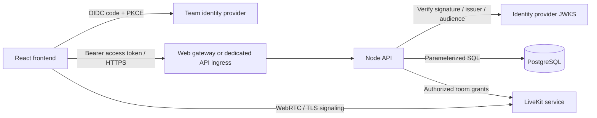

# Mayraviq architecture

Mayraviq is an internal team collaboration tool holding private business data. React and the Node API are separate applications with separate build outputs, container images, runtime configuration and deployment lifecycles. PostgreSQL is the durable store. A shared source repository does not require a shared deployment.

## Source boundaries

| Directory                          | Responsibility                                                             | Deployment                                            |
| ---------------------------------- | -------------------------------------------------------------------------- | ----------------------------------------------------- |
| `apps/web`                         | React UI, OIDC login, client request helper, design and room interactions  | Static Vite build, web Docker image or static hosting |
| `apps/api/src/modules/workspace`   | Workspaces, projects, sessions, decisions and project canvases             | API image                                             |
| `apps/api/src/modules/discussions` | Channels, peer discussions, memberships and messages                       | API image                                             |
| `apps/api/src/modules/rooms`       | Room access, guest invitations, notes, room designs and call grants        | API image                                             |
| `apps/api/src/platform`            | HTTP server, JWT verification, PostgreSQL driver, migration/import tooling | API image                                             |
| `apps/api/src/lib`                 | Shared request and rate-limit boundaries, room-token signing               | API image                                             |
| `apps/api/migrations`              | Ordered PostgreSQL schema migrations and constraints                       | One-shot migration job                                |
| `packages/contracts`               | Browser-safe data types, canvas validation and design geometry             | Imported into both builds; no service                 |
| `infra/docker`                     | Independent API/web Dockerfiles and web gateway configuration              | Infrastructure                                        |
| `tests`                            | Contract, identity, PostgreSQL, isolation and migration checks             | CI/development                                        |
| `docs`                             | Architecture, engineering rules, operations and security review            | Documentation                                         |

The API currently runs its business modules in one process. They share transaction boundaries and one database. This keeps decision review and audit writes atomic. Frontend and API deployment are independent; splitting every business module into a network service would introduce cross-service transactions before there is a demonstrated scaling need. Future extraction should follow measured load or ownership boundaries.

## HTTP and identity boundary

The frontend uses one request helper, `apps/web/src/auth.ts`. It attaches a short-lived access token. Tokens are held in memory; PKCE redirect state uses session storage. Reloading requires a fresh sign-in redirect, which an existing identity-provider session can satisfy. Production sign-in requires a configured team identity provider; placeholder configuration is not a working identity integration.

The API verifies asymmetric token signatures, issuer, audience and expiry using `jose`. Identity headers supplied by a caller have no effect. Authorization uses the verified subject and database membership. Configure the identity provider as a single team tenant and set `OIDC_REQUIRED_GROUP` to restrict access further. Email and display name are metadata, not authorization keys. Replacing the identity provider or issuer requires an explicit subject-mapping migration.

A development identity exists only when explicitly enabled, on an API bound to loopback, outside production. The compiled production frontend cannot enable it through runtime configuration. Development API users share one local identity; this is for preview, not an internal deployment.

The default production web gateway forwards `/api` to the separately built API container. For different hosts, use `PUBLIC_API_URL`, set the API `APP_ORIGIN` to the exact frontend origin, and expose the API through HTTPS ingress. The API permits that one origin and uses bearer tokens rather than ambient cookies. The gateway upstream is an operator setting, never a user-supplied URL.

## Persistence and concurrency

PostgreSQL stores explicit workspace, conversation and guest memberships. Room guests receive only invited-session access and a separate room canvas. Workspace access is not implied by a room invitation. Public channels are visible to workspace members; they are not internet-public.

The query adapter retains parameterized domain queries while translating placeholders to PostgreSQL. It never interpolates request values. Batch writes acquire one database connection and run under SERIALIZABLE isolation, with bounded retries for serialization conflicts. Optimistic versions prevent stale notes, decisions and canvas saves. Audit writes and their associated business updates commit together. Migrations use a dedicated connection and advisory lock; migrations run before API rollout, not automatically on every API process startup.

The initial schema preserves existing column representations to support a lossless SQLite import. JSON arrays are stored as validated text with PostgreSQL JSON validity constraints. Timestamps remain ISO strings. A later JSONB/timestamptz conversion should be an explicit versioned migration rather than an undocumented rewrite.

## Collaboration boundary

Audio/video uses an external LiveKit SFU, not the HTTP API process. The API authorizes each session before signing a five-minute room grant. SDK delivery and media traffic are separate from saved canvas and notes persistence. Calling stays unavailable until LiveKit is configured. The separate `dev:call` launcher supplies an explicit loopback-only service for local previews; production still requires a deployed WSS media endpoint.

Canvas broadcasts show live design previews; saved changes use version checks. Saved boards additionally support field-level three-way reconciliation and opt-in project/default room Live save, with periodic refresh. Same-field conflicts require review. This is not simultaneous CRDT coediting or a durable offline queue. Notes and action drafts can be prepared manually or suggested by the optional Ollama room assistant. AI requests stay within the authorized room and return validated drafts for explicit review. Recording, transcription and automatic execution are not implemented. Their future implementation requires consent, retention, background jobs and review before any external action.

## Scaling path

The web can scale independently as static assets. The API can run multiple replicas against PostgreSQL because identity and authorization do not rely on in-process sessions, and authenticated request limits are stored in the database. Size the database pool per replica; the current maximum is ten connections. Move request limits to a dedicated shared store when measured write traffic warrants it. Add server push and paginated history before increasing team size significantly; discussion aggregation remains bounded per conversation but not across all conversations.

## Optional AI deployment

`apps/api/src/modules/ai` owns model configuration, room-scoped context assembly and output validation. `packages/contracts/src/ai.ts` defines the browser-safe draft contract. `compose.ai.yaml` adds a separately hosted private Ollama service with persistent model storage. The browser calls the authenticated API, never the model directly. See [AI operations](AI.md).
